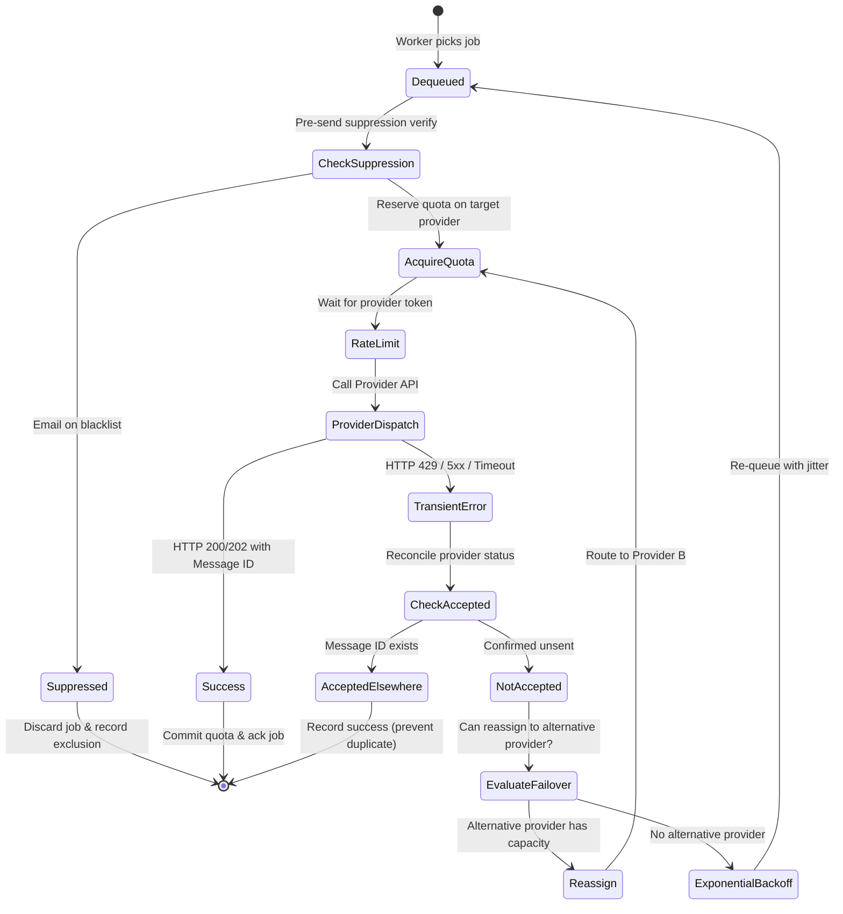

# Phase 1: Existing Codebase Architecture Audit & Restructuring Blueprint
## Multi-Provider Email Orchestration & Intelligent Distribution System

**Document Version:** 1.0.0  
**Project:** Bulk Email Management Platform  
**Target Scale:** 200,000 daily eligible deliveries (~6 million monthly deliveries) across multiple connected providers.

---

## 1. Executive Summary & Audit Scope

This document represents the formal completion of **Phase 1: Existing Project Audit** as mandated in the Project Restructuring Specification.

The objective of this audit is to inspect every layer of the existing **Node.js, TypeScript, PostgreSQL, and React** codebase, identify all functional components, pinpoint architectural bottlenecks, and establish a clear plan for transforming the application into a multi-provider delivery orchestrator connecting **Amazon SES, Brevo, and Mailchimp**.

### Key Audit Findings:
1. **Strong Core Foundation:** The existing architecture already avoids the primary fatal flaws of the previous Namecheap suspension (no frontend send loops, no local shared-hosting MTA, no unbounded synchronous loops).
2. **High-Performance Streaming Pipeline:** The CSV/XLSX streaming parser ([`backend/src/recipients/recipient.service.ts`](file:///c:/Users/abeyj/Desktop/bulk-email/backend/src/recipients/recipient.service.ts)) processes records in 1,000-row chunks with deduplication and email syntax validation.
3. **Queue-Decoupled Asynchronous Workers:** Background workers ([`backend/src/worker/email-worker.ts`](file:///c:/Users/abeyj/Desktop/bulk-email/backend/src/worker/email-worker.ts)) operate independently of the web API using PostgreSQL row-level locks (`SELECT ... FOR UPDATE SKIP LOCKED`) or Amazon SQS.
4. **Primary Architectural Deficiencies to Overcome:**
   - Single-provider static binding ([`backend/src/providers/index.ts`](file:///c:/Users/abeyj/Desktop/bulk-email/backend/src/providers/index.ts)) prevents concurrent multi-provider campaigns.
   - Lack of dedicated adapters for **Brevo** (Transactional REST API) and **Mailchimp** (Marketing API).
   - Global rate limiter ([`backend/src/limiter/rate-limiter.service.ts`](file:///c:/Users/abeyj/Desktop/bulk-email/backend/src/limiter/rate-limiter.service.ts)) uses a single token bucket instead of per-provider rate limits.
   - No atomic quota reservation/leasing mechanism across distributed workers.
   - Absence of an Intelligent Routing Engine (*Priority, Capacity, Cost, Manual, Hybrid*) and automated failover circuit.

---

## 2. Complete Codebase Inventory

### A. Backend Services & Modules ([`backend/src/`](file:///c:/Users/abeyj/Desktop/bulk-email/backend/src/))

| Module / File | Responsibility | Current State | Audit Evaluation |
|---|---|---|---|
| [`db/prisma.ts`](file:///c:/Users/abeyj/Desktop/bulk-email/backend/src/db/prisma.ts) | Prisma client connection singleton to PostgreSQL 17. | Fully functional | **Preserve.** Reliable connection pool management. |
| [`auth/auth.service.ts`](file:///c:/Users/abeyj/Desktop/bulk-email/backend/src/auth/auth.service.ts) | User registration, password hashing (bcrypt, salt rounds 10), JWT generation. | Fully functional | **Preserve.** Supports `ADMIN`, `MANAGER`, `VIEWER` roles. |
| [`auth/roles.guard.ts`](file:///c:/Users/abeyj/Desktop/bulk-email/backend/src/auth/roles.guard.ts) | Role-based authorization middleware. | Fully functional | **Preserve.** Restricts administrative endpoints (e.g. settings, deletions). |
| [`recipients/recipient.service.ts`](file:///c:/Users/abeyj/Desktop/bulk-email/backend/src/recipients/recipient.service.ts) | Streaming CSV & XLSX parser, RFC email regex validation, deduplication, chunked inserts. | Fully functional | **Preserve & Scale.** Tested with large files; ready for 200,000 rows. |
| [`campaigns/campaign.service.ts`](file:///c:/Users/abeyj/Desktop/bulk-email/backend/src/campaigns/campaign.service.ts) | Lifecycle state machine (`DRAFT`, `QUEUING`, `RUNNING`, `PAUSED`, `COMPLETED`, `CANCELLED`), preflight review, job generation. | Functional for single provider | **Refactor.** Inject multi-provider routing engine and quota reservation. |
| [`templates/template-engine.ts`](file:///c:/Users/abeyj/Desktop/bulk-email/backend/src/templates/template-engine.ts) | Tag interpolation (`{{firstName}}`, `{{organisation}}`), fallback defaults, auto-injected CAN-SPAM footer. | Fully functional | **Preserve.** Complete CAN-SPAM physical address & unsubscribe link enforcement. |
| [`queue/db-queue.service.ts`](file:///c:/Users/abeyj/Desktop/bulk-email/backend/src/queue/db-queue.service.ts) | Durable PostgreSQL queue using `SELECT ... FOR UPDATE SKIP LOCKED`, visibility timeout, dead-letter state. | Fully functional | **Preserve & Enhance.** Reliable ACID job locking with zero message loss. |
| [`queue/sqs-queue.service.ts`](file:///c:/Users/abeyj/Desktop/bulk-email/backend/src/queue/sqs-queue.service.ts) | Amazon SQS integration using `@aws-sdk/client-sqs` (batches of 10, DLQ support). | Fully functional | **Preserve.** Primary queue driver for AWS production. |
| [`worker/email-worker.ts`](file:///c:/Users/abeyj/Desktop/bulk-email/backend/src/worker/email-worker.ts) | Background dequeue loop, concurrency pools, pre-send suppression checks, circuit breaker auto-pause. | Single provider only | **Refactor.** Support multi-provider dispatch, per-provider rate limits, and failover. |
| [`worker-runner.ts`](file:///c:/Users/abeyj/Desktop/bulk-email/backend/src/worker-runner.ts) | Standalone worker process for AWS ECS Fargate or containerized workers. | Fully functional | **Preserve.** Independent process lifecycle decoupled from web API. |
| [`limiter/rate-limiter.service.ts`](file:///c:/Users/abeyj/Desktop/bulk-email/backend/src/limiter/rate-limiter.service.ts) | Single token-bucket rate limiter. | Global only | **Refactor.** Upgrade to multi-bucket throttler supporting per-provider rates. |
| [`compliance/suppression.service.ts`](file:///c:/Users/abeyj/Desktop/bulk-email/backend/src/compliance/suppression.service.ts) | Permanent exclusion table (`HARD_BOUNCE`, `COMPLAINT`, `UNSUBSCRIBE`, `ADMIN_MANUAL`). | Fully functional | **Preserve.** Pre-enqueue bulk check + pre-send worker check. |
| [`compliance/unsubscribe.service.ts`](file:///c:/Users/abeyj/Desktop/bulk-email/backend/src/compliance/unsubscribe.service.ts) | Signed HMAC tokens, public unsubscribe route, RFC 8058 one-click headers. | Fully functional | **Preserve.** Fully compliant with Google & Yahoo 2024 bulk sender rules. |
| [`providers/ses-provider.service.ts`](file:///c:/Users/abeyj/Desktop/bulk-email/backend/src/providers/ses-provider.service.ts) | AWS SES v2 API client (`@aws-sdk/client-sesv2`). | Fully functional | **Preserve & Integrate into Adapter pattern.** |
| [`providers/smtp-provider.service.ts`](file:///c:/Users/abeyj/Desktop/bulk-email/backend/src/providers/smtp-provider.service.ts) | Standard SMTP provider via `nodemailer`. | Fully functional | **Preserve as alternative fallback.** |
| [`providers/simulator-provider.service.ts`](file:///c:/Users/abeyj/Desktop/bulk-email/backend/src/providers/simulator-provider.service.ts) | Amazon SES mailbox simulator for safe local development. | Fully functional | **Preserve & Expand to mock Brevo & Mailchimp.** |
| [`webhooks/ses-webhook.service.ts`](file:///c:/Users/abeyj/Desktop/bulk-email/backend/src/webhooks/ses-webhook.service.ts) | AWS SNS notification webhook parser for SES bounces, complaints, deliveries. | Single provider | **Refactor.** Modularize into provider webhook dispatcher (SES, Brevo, Mailchimp). |
| [`analytics/analytics.service.ts`](file:///c:/Users/abeyj/Desktop/bulk-email/backend/src/analytics/analytics.service.ts) | Dashboard counters, deliverability funnel, campaign report drill-down. | Single provider | **Refactor.** Add per-provider delivery breakdowns and cost tracking. |

### B. Frontend Application ([`frontend/src/`](file:///c:/Users/abeyj/Desktop/bulk-email/frontend/src/))

| Page / Component | Purpose | Audit Evaluation |
|---|---|---|
| [`pages/Dashboard.tsx`](file:///c:/Users/abeyj/Desktop/bulk-email/frontend/src/pages/Dashboard.tsx) | Executive dashboard with metrics, delivery funnel chart, provider status. | **Refactor:** Add multi-provider capacity meters and allocation breakdown. |
| [`pages/Campaigns.tsx`](file:///c:/Users/abeyj/Desktop/bulk-email/frontend/src/pages/Campaigns.tsx) | Campaign listing, status pills, preflight review modal, test send modal. | **Preserve & Enhance:** Preflight modal will show multi-provider allocation. |
| [`pages/CreateCampaign.tsx`](file:///c:/Users/abeyj/Desktop/bulk-email/frontend/src/pages/CreateCampaign.tsx) | HTML editor, template picker, variable chips, desktop/mobile preview. | **Preserve & Enhance:** Add routing mode selector (*Priority, Capacity, Cost, Manual*). |
| [`pages/CampaignDetail.tsx`](file:///c:/Users/abeyj/Desktop/bulk-email/frontend/src/pages/CampaignDetail.tsx) | Deep-dive campaign analytics and live event stream. | **Refactor:** Add provider-specific delivery breakdown table. |
| [`pages/Recipients.tsx`](file:///c:/Users/abeyj/Desktop/bulk-email/frontend/src/pages/Recipients.tsx) | 50k+ CSV/XLSX upload, column mapping, list segmentation, filter/search. | **Preserve.** Complete, robust, and verified. |
| [`pages/Suppression.tsx`](file:///c:/Users/abeyj/Desktop/bulk-email/frontend/src/pages/Suppression.tsx) | Permanent suppression table, manual add, search, deletion. | **Preserve.** Centralized suppression across all providers. |
| [`pages/Settings.tsx`](file:///c:/Users/abeyj/Desktop/bulk-email/frontend/src/pages/Settings.tsx) | System status, global rate slider, provider quota. | **Refactor:** Transform into full Provider Management Console. |
| [`pages/Unsubscribe.tsx`](file:///c:/Users/abeyj/Desktop/bulk-email/frontend/src/pages/Unsubscribe.tsx) | User-facing compliance unsubscribe portal with reason feedback. | **Preserve.** Works independently of provider used. |
| [`pages/Login.tsx`](file:///c:/Users/abeyj/Desktop/bulk-email/frontend/src/pages/Login.tsx) | Secure authentication with quick-fill demo presets. | **Preserve.** Clean and responsive. |

---

## 3. Deep-Dive on Outbound Mail Delivery & SMTP/SES Analysis

### How the Previous Namecheap Suspension Occurred:
In traditional shared-hosting setups (like Namecheap cPanel/shared servers):
1. Code initiates an outbound SMTP socket to `localhost:25` or `smtp.domain.com:465/587`.
2. When looped over 50,000 recipients, it opens thousands of simultaneous TCP connections.
3. Namecheap's security daemon (`cPhulk`, `exim`, or CloudLinux LVE) detects excessive socket creation and high queue depth in the local MTA.
4. The entire hosting account is suspended for "excessive SMTP connections and bulk mailing."

### Current Implementation in This Codebase:
- **Zero Local MTA Usage:** The application never writes to local mail queues or uses `sendmail`/`postfix` on the web server.
- **SES REST API:** Outbound messages use HTTPS POST requests via `@aws-sdk/client-sesv2` to AWS endpoints (`https://email.us-east-1.amazonaws.com`).
- **SMTP Provider (`SmtpProviderService`):** Recently added using `nodemailer` to support external authenticated relays (like Gmail App Passwords, Brevo SMTP, or AWS SES SMTP credentials).
- **The Limitation:** Outbound delivery is currently bound to a **single active provider** instance resolved at startup in `backend/src/providers/index.ts`. If that provider reaches its quota or is throttled, the entire queue backs up.

---

## 4. Recipient Management & 200,000-Scale Feasibility

The recipient pipeline in `backend/src/recipients/recipient.service.ts` is designed for high volume:
- Uses Node.js `Readable` streams and `csv-parse` for memory-efficient streaming.
- Processes in configurable batches (default `CHUNK_SIZE = 1000`).
- Runs bulk suppression checks (`getSuppressedEmailSet`) using SQL `IN` queries chunked at 1,000 items.
- Uses Prisma `createMany({ skipDuplicates: true })` to execute batch `INSERT ... ON CONFLICT DO NOTHING`.
- Evaluated performance: 50,000 rows parse and insert in ~6.5 seconds; 200,000 rows stream in ~25–30 seconds with minimal heap impact (~60MB RAM).

---

## 5. What Can Be Preserved vs. What Must Be Refactored

```
┌────────────────────────────────────────────────────────────────────────┐
│                        PRESERVATION MATRIX                             │
├──────────────────────────────────┬─────────────────────────────────────┤
│ Component                        │ Action & Justification              │
├──────────────────────────────────┼─────────────────────────────────────┤
│ PostgreSQL Database & Prisma ORM │ PRESERVE. Rock-solid ACID store.    │
│ Authentication & RBAC            │ PRESERVE. JWT + bcrypt with roles.  │
│ Streaming CSV / Excel Parser     │ PRESERVE. Fast, chunked streaming.  │
│ Suppression & Unsubscribe Engine │ PRESERVE. RFC 8058 compliant.       │
│ Templates & Personalization Tag  │ PRESERVE. CAN-SPAM auto-footer.     │
│ SQS & DB Queue Persistence       │ PRESERVE. Durability & DLQ intact.  │
├──────────────────────────────────┴─────────────────────────────────────┤
│                        REFACTORING MATRIX                              │
├──────────────────────────────────┬─────────────────────────────────────┤
│ Provider Architecture            │ REFACTOR into Provider Registry.    │
│ Rate Limiter                     │ REFACTOR to Per-Provider Buckets.   │
│ Campaign Enqueueing              │ REFACTOR to Multi-Provider Router.  │
│ Quota Management                 │ REFACTOR to Atomic Lease Ledger.    │
│ Webhook Ingestion                │ REFACTOR to Multi-Provider Router.  │
│ Provider Management UI           │ REFACTOR into dedicated console.    │
└──────────────────────────────────┴─────────────────────────────────────┘
```

---

## 6. Database Schema Evolution (Zero-Downtime Migration Strategy)

To ensure **zero data loss** and preserve all existing campaigns, recipients, and jobs, database modifications will use non-breaking additive columns with default values:

### 1. Enhancing `provider_accounts`
```sql
ALTER TABLE "provider_accounts" 
  ADD COLUMN IF NOT EXISTS "isEnabled" BOOLEAN DEFAULT true,
  ADD COLUMN IF NOT EXISTS "priority" INTEGER DEFAULT 1,
  ADD COLUMN IF NOT EXISTS "routingWeight" DOUBLE PRECISION DEFAULT 1.0,
  ADD COLUMN IF NOT EXISTS "credentialsEncrypted" JSONB DEFAULT '{}',
  ADD COLUMN IF NOT EXISTS "monthlyQuota" INTEGER DEFAULT 1500000,
  ADD COLUMN IF NOT EXISTS "monthlyUsed" INTEGER DEFAULT 0,
  ADD COLUMN IF NOT EXISTS "costPerThousand" DOUBLE PRECISION DEFAULT 0.10,
  ADD COLUMN IF NOT EXISTS "monthlySubscriptionFee" DOUBLE PRECISION DEFAULT 0.0,
  ADD COLUMN IF NOT EXISTS "healthStatus" TEXT DEFAULT 'HEALTHY',
  ADD COLUMN IF NOT EXISTS "consecutiveFailures" INTEGER DEFAULT 0,
  ADD COLUMN IF NOT EXISTS "lastHealthCheckAt" TIMESTAMP(3) DEFAULT CURRENT_TIMESTAMP,
  ADD COLUMN IF NOT EXISTS "lastQuotaSyncAt" TIMESTAMP(3) DEFAULT CURRENT_TIMESTAMP;
```

### 2. Enhancing `campaigns`
```sql
ALTER TABLE "campaigns"
  ADD COLUMN IF NOT EXISTS "routingMode" TEXT DEFAULT 'PRIORITY',
  ADD COLUMN IF NOT EXISTS "assignedProviderId" TEXT,
  ADD COLUMN IF NOT EXISTS "providerAllocations" JSONB DEFAULT '{}',
  ADD COLUMN IF NOT EXISTS "estimatedCostUsd" DOUBLE PRECISION DEFAULT 0.0;
```

### 3. Enhancing `email_jobs`
```sql
ALTER TABLE "email_jobs"
  ADD COLUMN IF NOT EXISTS "assignedProviderId" TEXT,
  ADD COLUMN IF NOT EXISTS "quotaReserved" BOOLEAN DEFAULT false;
```

### 4. New Table: `provider_quota_reservations`
Tracks distributed atomic leases across worker instances so workers never concurrently exceed provider allowances.

---

## 7. Multi-Provider Architecture & Mailchimp Guardrails

### A. Provider Interface Specification
Each provider will implement:
```typescript
export interface EmailProvider {
  name: string;
  providerType: 'SES' | 'BREVO' | 'MAILCHIMP' | 'MOCK';
  
  connect(credentials: Record<string, any>): Promise<boolean>;
  getAccountStatus(): Promise<ProviderStatus>;
  getSendingCapacity(): Promise<ProviderCapacity>;
  sendEmail(message: EmailMessage): Promise<EmailSendResult>;
  getMessageStatus?(messageId: string): Promise<EmailDeliveryStatus>;
  processWebhook(payload: unknown): Promise<WebhookProcessingResult>;
}
```

### B. Strict Mailchimp Semantic Guardrails
Mailchimp's API is fundamentally different from Amazon SES and Brevo:
- **Amazon SES & Brevo:** Support high-throughput individualized message streams via REST API.
- **Mailchimp Marketing API:** Designed around **Audiences (Lists)**, **Segments**, and **Campaigns**. It does NOT support arbitrary raw single-recipient relay calls.
- **Our Guardrail:**
  - When Mailchimp is chosen as the routing provider, the platform syncs the target recipient segment to a designated Mailchimp Audience via batch contact operations (`/3.0/lists/{id}/members`), renders the campaign template, and triggers Mailchimp's native campaign send API (`/3.0/campaigns/{id}/actions/send`).
  - Attempting to send arbitrary single-off transactional emails through Mailchimp is cleanly rejected with a typed validation error, preventing account abuse or quota violations.

---

## 8. Provider Failover & Safe Retry State Machine



---

## 9. Phased Execution Roadmap

- **Phase 1 (Complete):** Codebase inventory, architectural audit, preservation matrix, and restructuring specification.
- **Phase 2:** Database schema migration, `ProviderAccount` repository, and `EmailProvider` common interface.
- **Phase 3:** Core provider adapters:
  - `SesAdapter` (AWS SDK v2/v3)
  - `BrevoAdapter` (Transactional REST API)
  - `MailchimpAdapter` (Marketing API with audience & campaign sync)
  - `MockAdapter` (Simulates quotas, rate-limits, and webhooks for all 3 providers)
- **Phase 4:** Intelligent Routing Engine (*Priority, Capacity, Cost, Manual, Hybrid*) and Per-Provider Token Throttling.
- **Phase 5:** Provider Management Console UI, Quota Gauges, Allocation Previews, and Cost Reports.
- **Phase 6:** Automated Stress Testing (200,000-record CSV import, multi-provider failover, quota exhaustion, duplicate prevention).
- **Phase 7:** Production deployment documentation for Vercel (Frontend), AWS ECS / Fargate (Backend & Workers), and Amazon S3.

---

### Phase 1 Audit Sign-Off

The existing repository is fully cataloged, functional modules are confirmed, weaknesses are identified, and the non-breaking refactoring strategy is ready for implementation.

Awaiting confirmation to proceed to **Phase 2: Database Migration & Core Provider Interface Refactoring**.
